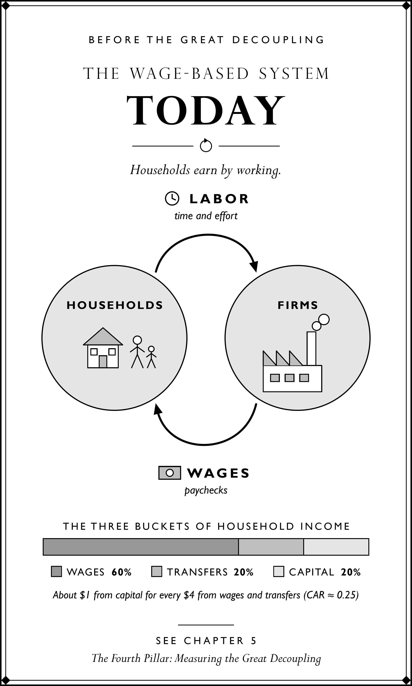
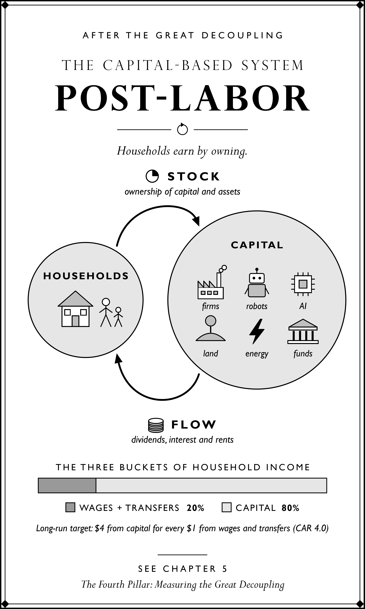
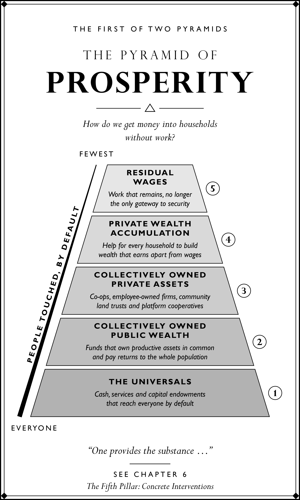
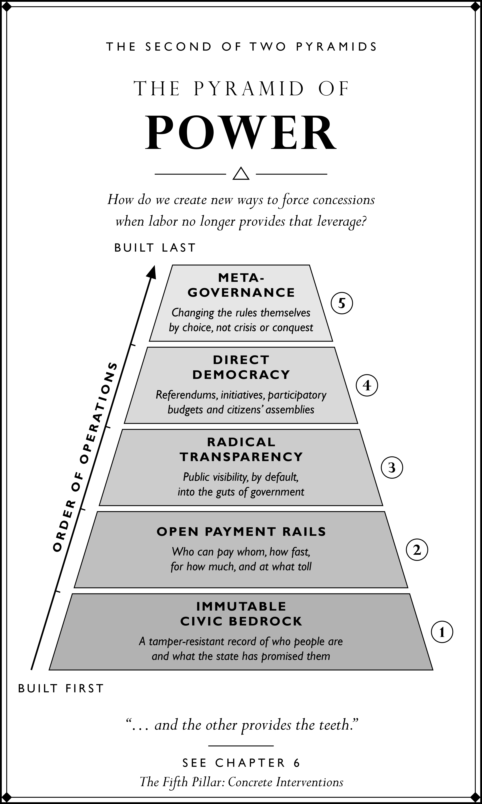

# Labor Zero: Online Companion

Free companion material for *Labor Zero: AI, Automation, and the Last Employed Generation*, by David Shapiro.

## Appendix and Bibliography

- [Appendix: Measuring Ownership Income](Labor_Zero_Appendix_Measuring_Ownership_Income.pdf) (PDF, 15 pages). The full appendix, with its formulas and tables.
- [Bibliography](Labor_Zero_Bibliography.pdf) (PDF, 82 pages). The book's complete bibliography.

## The four graphics from the front of the book

Two facing pairs: the two systems, then the two pyramids. *"One provides the substance … and the other provides the teeth."* (Chapter 6)

### Today: the wage-based system

Before the Great Decoupling. Households earn by working.

[PDF for print](plates/LZ_plate_cycle_today_4.5x7.5in.pdf) · [PNG, 600 dpi](plates/LZ_plate_cycle_today_4.5x7.5in_600dpi.png) · [SVG source](plates/LZ_plate_cycle_today.svg)

### Post-Labor: the capital-based system

After the Great Decoupling. Households earn by owning.

[PDF for print](plates/LZ_plate_cycle_postlabor_4.5x7.5in.pdf) · [PNG, 600 dpi](plates/LZ_plate_cycle_postlabor_4.5x7.5in_600dpi.png) · [SVG source](plates/LZ_plate_cycle_postlabor.svg)

### The Pyramid of Prosperity

The five tiers of post-labor household income.

[PDF for print](plates/LZ_plate_pyramid_of_prosperity_4.5x7.5in.pdf) · [PNG, 600 dpi](plates/LZ_plate_pyramid_of_prosperity_4.5x7.5in_600dpi.png) · [SVG source](plates/LZ_plate_pyramid_of_prosperity.svg)

### The Pyramid of Power

The five layers of a new social contract.

[PDF for print](plates/LZ_plate_pyramid_of_power_4.5x7.5in.pdf) · [PNG, 600 dpi](plates/LZ_plate_pyramid_of_power_4.5x7.5in_600dpi.png) · [SVG source](plates/LZ_plate_pyramid_of_power.svg)

The PDFs have their fonts built in, so they are the ones to print and share. The SVG sources are for editing and need the Perpetua and Gill Sans MT fonts installed.

## Supplementary papers

- [Derived and Essential Demand](supplements/Post-Labor_Economics_Derived_and_Essential_Demand.pdf) (PDF, 161 pages). Human work, income distribution, and the Fourth Sector: what human work remains when machines can supply the functional result, and whether its earnings can support broad livelihoods.
- [Post-Labor Household Income Interventions](supplements/Post-Labor_Economics_Household_Income_Interventions.pdf) (PDF, 63 pages). A catalogue of 213 programs implemented or tested worldwide, from citizen dividends and asset accounts to worker ownership, guaranteed income, conditional and emergency cash, and public jobs.
- [Post-Labor Economics Metrics Reference](supplements/Post-Labor_Economics_Metrics_Reference.pdf) (PDF, 764 pages). A consolidated glossary of labor, capital, household and automation evidence, in 140 standalone metric chapters.

## Corrections

No corrections so far.

## The QR code in the book

The QR code printed in *Labor Zero* opens this page.

[SVG](qr/Labor_Zero_QR_online.svg) · [PDF](qr/Labor_Zero_QR_online.pdf) · [PNG](qr/Labor_Zero_QR_online.png)

---

[← Post-Labor Economics home](../) · [Research library](../research/)

© 2026 David Shapiro. All rights reserved.
